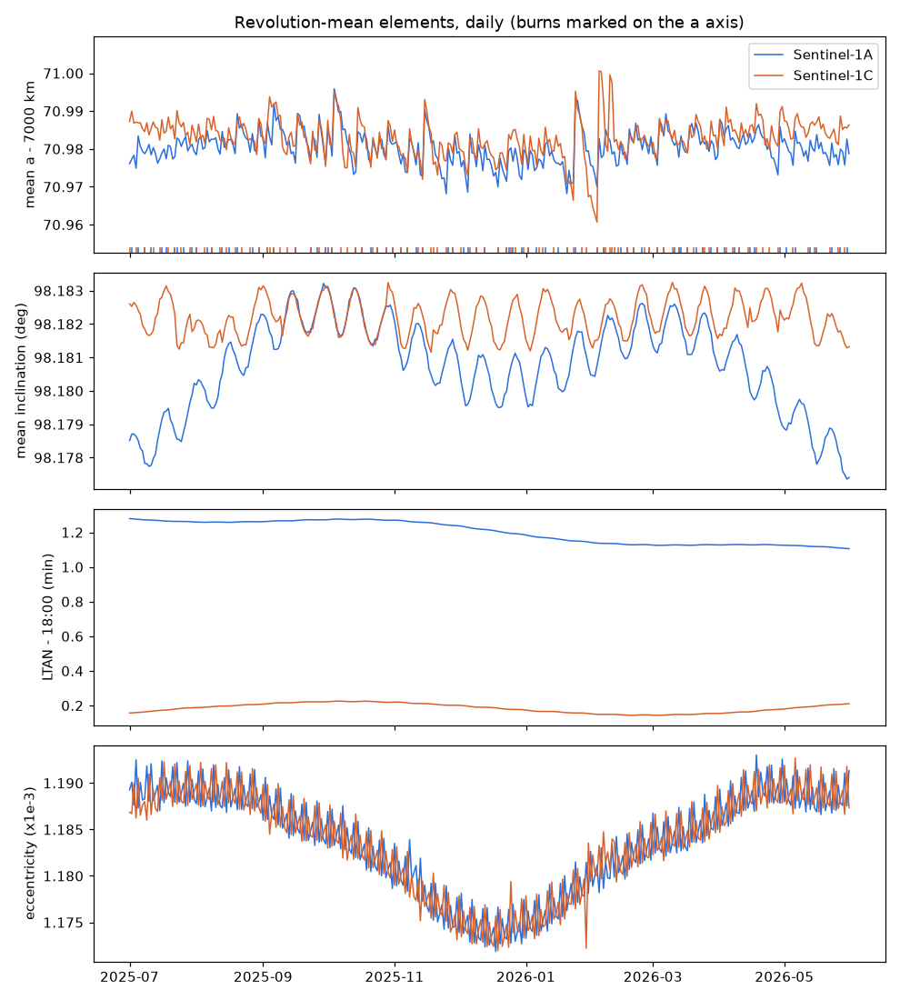
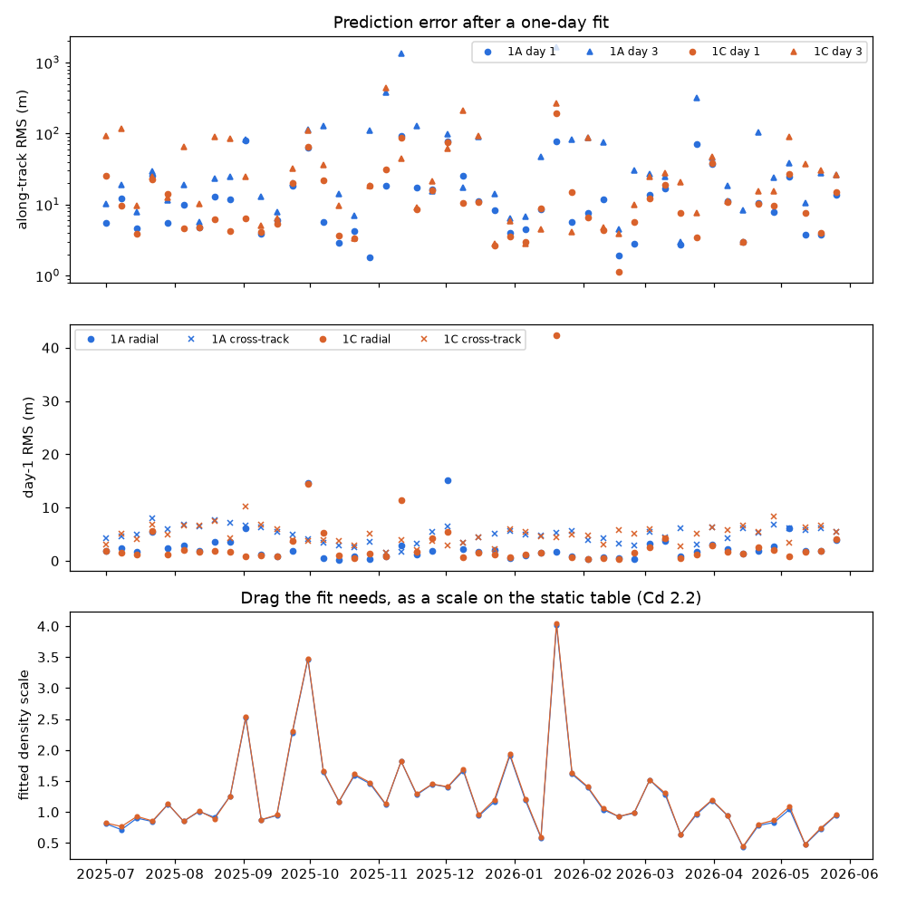

# Sentinel-1A and 1C: eleven months of precise orbits

Generated by `tools/sentinel1_study.py report` from the CSVs beside it. Contains modified Copernicus Sentinel data 2025-2026 (ESA POEORB precise orbits).

## Long-term series

| satellite | span | days | mean a (km) | a range (km) | i (deg) | LTAN - 18:00 (min) | e (1e-3) | argp (deg) | track offset median RMS / max (m) |
|---|---|---|---|---|---|---|---|---|---|
| Sentinel-1A | 2025-07-01 .. 2026-05-31 | 335 | 7070.980 | 7070.968 .. 7070.996 | 98.1808 | +1.2 | 1.184 | 90.0 | 23 / 264 |
| Sentinel-1C | 2025-07-01 .. 2026-05-31 | 335 | 7070.983 | 7070.961 .. 7071.001 | 98.1822 | +0.2 | 1.184 | 90.0 | 23 / 303 |

Track offset: how far east or west each equator crossing lands from its relative orbit's usual (median) crossing, on the days within 1 km of it.

1C flies 176.292 deg behind 1A on average (daily means 175.887 .. 176.735; 180 nominal).

## Burns

The DEGRADED-MANOEUVRE windows, those under 3 h apart taken as one manoeuvre, each sized from the step in the revolution means across it (fitted with the drag's decay and the daily wobble; `burns.csv`). Cross-track is the least the change in inclination needs.

| satellite | manoeuvres | burns | days apart | sized | median along (mm/s) | total along (mm/s) | median cross (mm/s) | total cross (mm/s) |
|---|---|---|---|---|---|---|---|---|
| Sentinel-1A | 83 | 120 | 4.0 | 76 | 4.13 | 364 | 34.17 | 2491 |
| Sentinel-1C | 97 | 191 | 3.5 | 89 | 3.52 | 386 | 29.31 | 3651 |

- Sentinel-1A: 78 placebo windows (midway between manoeuvres, where nothing burned) size to a spread of 2.4 m in a (1.29 mm/s along-track) and 0.17 mdeg in i (21.7 mm/s cross-track): the method's noise.
- Sentinel-1C: 86 placebo windows (midway between manoeuvres, where nothing burned) size to a spread of 2.7 m in a (1.45 mm/s along-track) and 0.17 mdeg in i (21.8 mm/s cross-track): the method's noise.

So the series sizes the along-track part of a burn (a few mm/s, against about 2 mm/s of noise), but not the cross-track part: Sentinel-1's inclination trims are a few mm/s and the mean inclination's own wobble is worth about 30. The accuracy arcs' fitted impulses resolve both.

## Accuracy arcs

Each week, a day of each satellite is fitted (start state, drag as a density scale, an impulse per burn; Cr held at 1.3; EGM2008 70x70, drag, Sun, Moon, SRP) and flown three days on against the truth, with only the later burns fitted. RMS in metres, median (90th percentile) over the arcs:

| satellite | span | radial | along-track | cross-track |
|---|---|---|---|---|
| Sentinel-1A | fit day | 0.4 (0.6) | 0.8 (1.2) | 1.4 (1.9) |
| Sentinel-1A | day 1 | 1.8 (4.4) | 10.3 (65.3) | 5.2 (6.7) |
| Sentinel-1A | day 2 | 2.7 (5.9) | 22.6 (105.9) | 8.0 (12.1) |
| Sentinel-1A | day 3 | 4.3 (7.8) | 24.7 (128.4) | 12.6 (18.5) |
| Sentinel-1C | fit day | 0.3 (0.5) | 0.7 (1.1) | 1.4 (1.8) |
| Sentinel-1C | day 1 | 1.6 (5.3) | 9.1 (33.3) | 5.0 (6.7) |
| Sentinel-1C | day 2 | 2.5 (4.9) | 18.3 (69.3) | 6.5 (11.9) |
| Sentinel-1C | day 3 | 3.9 (7.5) | 22.9 (97.8) | 10.1 (17.9) |

- Sentinel-1A: 48 arcs; fitted density scale 1.26 mean (0.43 .. 4.01), so the span's mean Cd at 10 m^2 on the static table is 2.78.
- Sentinel-1C: 48 arcs; fitted density scale 1.28 mean (0.44 .. 4.05), so the span's mean Cd at 10 m^2 on the static table is 2.81.
- Spans cut at a burn (an impulse needs half an hour of data after its window): 11 fits shorter than a day (shortest 23.4 h), 19 checks shorter than three days (shortest 71.4 h).

## Figures

